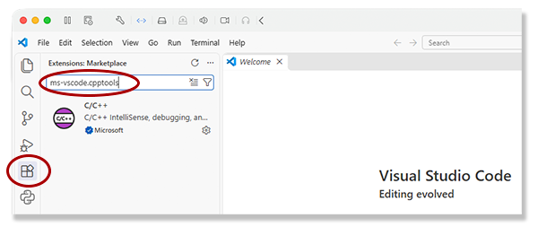

# C/C++ Setup for Apple macOS

## Build Tools

This scenario is for building a clean new Apple macOS classroom image with the suite of C/C++ commands and VS Code.
These steps should be performed as the user/participant who will be using the computer for class, not an administrator.

To do this for your personal computer you must adapt the installation steps to allow for any tools
tools that may have been previously installed.

Step one is to install the Homebrew package manager from the Internet.
$ is the command prompt:

```sh
$ /bin/bash -c "$(curl -fsSL https://raw.githubusercontent.com/Homebrew/install/HEAD/install.sh)"
$
```

Install the Gnu compiler, *make*, *cmake*, *ninja*, and Visual Studio Code using Homebrew.
The tool installations are separated to facilitate addressing any errors or warnings for each tool:

```sh
$ brew install gcc
$ brew install make
$ brew install cmake
$ brew install ninja
$ brew install --cask visual-studio-code
$
```

## Update the Path

This step must be performed for all users who will use the C/C++ development environment.

Add the Homebrew bin path to the ~/.zprofile so the commands are found at runtime:

```sh
$ sudo echo 'export PATH=$PATH:/opt/homebrew/bin' >> ~/.zprofile
```

## Visual Studio Code

This step must be performed for all users who will use the C/C++ development environment.

When VS Code is opened it will read the path.
It opens Zsh as the command shell in the embedded terminal window and the tools are available.
Running the `gcc` command in the terminal window will compile C/C++ programs.
The Microsoft C/C++ extension must be installed to enable running and debugging
programs from within the IDE.

Open the VS Code application.
On the left-side *Activity Bar* select the extensions icon (puzzle piece).
In the extensions search bar enter *ms-vscode.cpptools*.
Click on the extension in the list, this will load the page for the extension into the editor window.
Click the *Install* button.



## Wrap-up

During class or for personal use in a project
refer to the instructions for the [launch configuration instructions](../../README.md/#launch-configuration) to enable compiling and running the open C/C++ source file or building a project with *make* from
the user interface in the IDE.