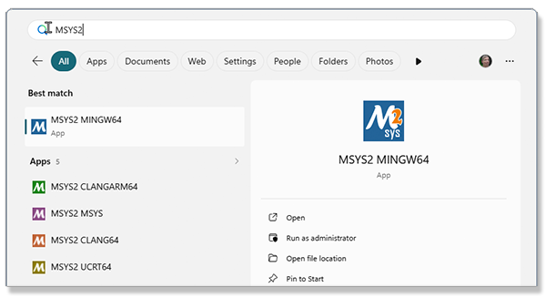
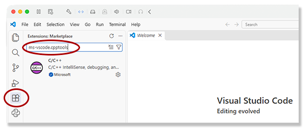

# C/C++ Setup for Microsoft Windows

The generic toolchain to develop for C & C++ in the Windows environment depends on MSYS2, UCRT64, and VS Code.
The installation of MSYS2 is via the Windows package manager.
Open a PowerShell window and run the following command ($ is the command prompt):

```sh
$ winget install --id MSYS2.MSYS2 -e
```

This installs MSYS2 which has a variety of terminal windows, each with its own predefined configuration.
Click on the Windows menu icon and search for MSYS2:



Our choice is to use the *UCRT64 toolchain*, which is the one the Microsoft distributes.
Click on the `MSYS2 UCRT64` icon to open the terminal window.
At the command prompt ($ in this example), run the following `pacman` command to use the MSYS2 package
manager to install the toolchain.
The commands are Intel-based, but the toolchain will run on a Windows computer using the ARM64 processor.

```sh
$ pacman -S --needed base-devel mingw-w64-ucrt-x86_64-toolchain
:: There are 13 members in group mingw-w64-ucrt-x86_64-toolchain:
:: Repository ucrt64
   1) mingw-w64-ucrt-x86_64-binutils  2) mingw-w64-ucrt-x86_64-crt  3) mingw-w64-ucrt-x86_64-gcc
   4) mingw-w64-ucrt-x86_64-gdb  5) mingw-w64-ucrt-x86_64-gdb-multiarch
   6) mingw-w64-ucrt-x86_64-headers  7) mingw-w64-ucrt-x86_64-libmangle
   8) mingw-w64-ucrt-x86_64-libwinpthread  9) mingw-w64-ucrt-x86_64-make
   10) mingw-w64-ucrt-x86_64-pkgconf  11) mingw-w64-ucrt-x86_64-tools
   12) mingw-w64-ucrt-x86_64-winpthreads  13) mingw-w64-ucrt-x86_64-winstorecompat

Enter a selection (default=all):
resolving dependencies...
looking for conflicting packages...

...
(55/55) installing mingw-w64-ucrt-x86_64-winstorecompat      [###############################] 100%
:: Running post-transaction hooks...
(1/1) Updating the info directory file...
$
```

Run the following `pacman` command to install the MINGW *make* utility:

```sh
$ pacman -S make
```

Unfortunately the default environment PATH variable does not include the *C:/msys64/ucrt64/bin* and
*C:/msys64/usr/bin* folders.
Go back to the PowerShell window and run the following two commands:

```sh
$ [Environment]::SetEnvironmentVariable('Path', [Environment]::GetEnvironmentVariable('Path', 'User') + ';C:\msys64\ucrt64\bin', 'User')
$ [Environment]::SetEnvironmentVariable('Path', [Environment]::GetEnvironmentVariable('Path', 'User') + ';C:\msys64\usr\bin', 'User')
```

Close and reopen the PowerShell window to read the new path.
Verify that the toolchain and *make* are present by running the following three commands to get the version for
`gcc`, `gdb`, and `make`.
Your version numbers may differ:

```sh
$ gcc --version
gcc.exe (Rev4, Built by MSYS2 project) 16.1.0
Copyright (C) 2026 Free Software Foundation, Inc.
This is free software; see the source for copying conditions.  There is NO
warranty; not even for MERCHANTABILITY or FITNESS FOR A PARTICULAR PURPOSE.
$ gdb --version
GNU gdb (GDB) 17.2
Copyright (C) 2025 Free Software Foundation, Inc.
License GPLv3+: GNU GPL version 3 or later <http://gnu.org/licenses/gpl.html>
This is free software: you are free to change and redistribute it.
There is NO WARRANTY, to the extent permitted by law.
$make --version
GNU Make 4.4.1
Built for x86_64-pc-msys
Copyright (C) 1988-2023 Free Software Foundation, Inc.
License GPLv3+: GNU GPL version 3 or later <https://gnu.org/licenses/gpl.html>
This is free software: you are free to change and redistribute it.
There is NO WARRANTY, to the extent permitted by law.
$ 
```

When VS Code is opened it will read the new path, and it opens PowerShell as the command shell in
the embedded terminal window.
Running the `gcc` command in the terminal window will not compile C/C++ programs.

Run VS Code.
On the left-side *Activity Bar* select the extensions icon (puzzle piece).
In the extensions search bar enter *ms-vscode.cpptools*.
Click on the extension in the list, this will load the page for the extension into the editor window.
If the extension is not already installed, install it.



Refer to the instructions for the [launch configuration instructions](../../README.md/#launch-configuration) to enable compiling and running the open C/C++ source file from
the user interface in the IDE.
