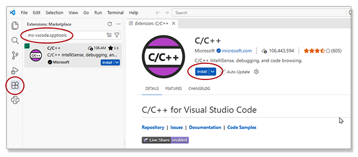

# C/C++ Setup for Microsoft Windows

This scenario is for building a clean new Microsoft Windows classroom image with the suite of C/C++ commands and VS Code.
To do this for your personal computer you must adapt the installation steps to allow for any tools
tools that may have been previously installed.

Signed-on as the target user open a PowerShell window and use the Windows Package Manager
to install Visual Studio Code ($ is the command prompt):

```powershell
$ winget install Microsoft.VisualStudioCode --scope machine
```

The generic toolchain to develop for C & C++ in the Windows environment depends on MSYS2, UCRT64, and VS Code:

```powershell
$ winget install --id MSYS2.MSYS2 -e
```

This installs MSYS2 which has a variety of terminal windows, each with its own predefined configuration.
Click on the Windows *Start button* on the task bar and search for MSYS2:


Microsoft distributes the *UCRT64 toolchain* which will be our choice.
Click on the `MSYS2 UCRT64` icon to open that *MSYS2 UCRT64 terminal* window.
At the command prompt ($ in this example), run the following `pacman` command to use the MSYS2 package
manager to install the toolchain.
Note: the tools are Intel-based but will run on a Windows computer with the ARM64 processor:

```sh
$ pacman -S --needed base-devel mingw-w64-ucrt-x86_64-toolchain
:: There are 13 members in group mingw-w64-ucrt-x86_64-toolchain:
:: Repository ucrt64
   1) mingw-w64-ucrt-x86_64-binutils  2) mingw-w64-ucrt-x86_64-crt  3) mingw-w64-ucrt-x86_64-gcc
   4) mingw-w64-ucrt-x86_64-gdb  5) mingw-w64-ucrt-x86_64-gdb-multiarch
   6) mingw-w64-ucrt-x86_64-headers  7) mingw-w64-ucrt-x86_64-libmangle
   8) mingw-w64-ucrt-x86_64-libwinpthread  9) mingw-w64-ucrt-x86_64-make
   10) mingw-w64-ucrt-x86_64-pkgconf  11) mingw-w64-ucrt-x86_64-tools
   12) mingw-w64-ucrt-x86_64-winpthreads  13) mingw-w64-ucrt-x86_64-winstorecompat

Enter a selection (default=all):
resolving dependencies...
looking for conflicting packages...

...
(55/55) installing mingw-w64-ucrt-x86_64-winstorecompat      [###############################] 100%
:: Running post-transaction hooks...
(1/1) Updating the info directory file...
$
```

Run the following `pacman` commands to install MINGW *make*, UCRT64 *cmake*, and UCRT64 *ninja*:

```sh
$ pacman -S make
$ pacman -S mingw-w64-ucrt-x86_64-cmake
$ pacman -S mingw-w64-ucrt-x86_64-ninja
```

Close the *MYSYS2 UCRT64 terminal* window.

## Update the Path

This step must be performed for all users who will use the C/C++ development environment.

VS Code and MSYS2 were installed for all users of the computer.
Unfortunately the default environment PATH variable does not include the *C:/msys64/ucrt64/bin* and
*C:/msys64/usr/bin* folders.
In the PowerShell window (open one if necessary) run the following two commands:

```powershell
$ [Environment]::SetEnvironmentVariable('Path', [Environment]::GetEnvironmentVariable('Path', 'User') + ';C:\msys64\ucrt64\bin', 'User')
$ [Environment]::SetEnvironmentVariable('Path', [Environment]::GetEnvironmentVariable('Path', 'User') + ';C:\msys64\usr\bin', 'User')
```

Close the Powershell window.

## Configure Visual Studio Code

This step must be performed for all users who will use the C/C++ development environment.

When VS Code is opened it will read the new path.
It opens PowerShell as the command shell in the embedded terminal window and the tools are available.
Running the `gcc` command in the terminal window will compile C/C++ programs.
The Microsoft C/C++ extension must be installed to enable running and debugging
programs from within the IDE.

Launch VS Code.
On the left-side *Activity Bar* select the extensions icon (puzzle piece).
This opens the extensions view in the *Sidebar* panel at the left.
In the search bar at the top enter *ms-vscode.cpptools*.
Click on the extension in the list, this will load the page for the extension into the editor window.
Click the *Install* button.



## Wrap-up

During class or for personal use in a project
refer to the instructions for the [launch configuration instructions](../../README.md/#launch-configuration) to enable compiling and running the open C/C++ source file or building a project with *make* from
the user interface in the IDE.
