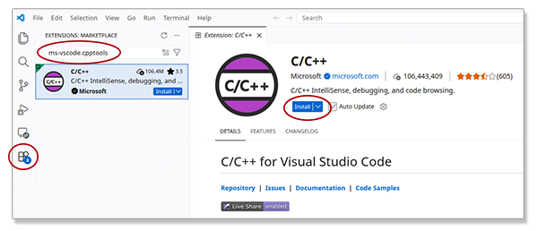

# C/C++ Setup for Ubuntu Linux

## Build Tools

This scenario is for building a clean new Ubuntu classroom image with the suite of C/C++ commands and VS Code.
To do this for your personal computer you must adapt the installation steps to allow for any tools
tools that may have been previously installed.

Use `sudo` and `apt` to install the the build tools including gcc and make, and the debugger, if they are
not installed.
The tool installations are separated to facilitate addressing any errors or warnings for each tool.
$ is the command prompt:

```sh
$ sudo apt update
$ sudo apt install build-essential
$ sudo apt install gdb
$ sudo apt install cmake
$ sudo apt ninja-build
$ 
```

## Visual Studio Code

Visual studio code is not available through the Ubuntu repositories.
Visit the [VS Code download page](https://code.visualstudio.com/download) and click the button to
download the *deb* installation file for *Debian/Ubuntu Linux*.

In the terminal window make sure you are in your home directory by using the command `cd`,
then change directory to the *Downloads* folder.
Install the *deb* file using `apt`.
Your filename may vary depending on the version number, so this installation command uses the asterisk to match then name:

```sh
$ cd
$ cd Downloads
$ sudo app install ./code_*.deb
$
```

## Configure Visual Studio Code

This step must be performed for all users who will use the C/C++ development environment.

When VS Code is opened it will read the path.
It opens Bash as the command shell in the embedded terminal window and the tools are available.
Running the `gcc` command in the terminal window will compile C/C++ programs.
The Microsoft C/C++ extension must be installed to enable running and debugging
programs from within the IDE.

Open the VS Code application.
On the left-side *Activity Bar* select the extensions icon (puzzle piece).
In the extensions search bar enter *ms-vscode.cpptools*.
Click on the extension in the list, this will load the page for the extension into the editor window.
Click the *Install* button.



## Wrap-up

During class or for personal use in a project
refer to the instructions for the [launch configuration instructions](../../README.md/#launch-configuration) to enable compiling and running the open C/C++ source file or building a project with *make* from
the user interface in the IDE.