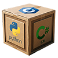

[//]: # (README.md)
[//]: # (Copyright © 2026 nTier Training. All rights reserved.)
[//]: #


<div align="right">
    A <a href="https://github.com/boxwrx">Box Works</a> Coding Environment
</div>

# Introduction

This repository defines how to install the C/C++ development environment for Microsoft Windows, Apple macOS, and Ubuntu Linux.
The envrionment consists of the C/C++ compiler, Visual Studio Code, and a launch configuration in VS Code to run the file
currently visible in the editor.

The *launch configuration* used by VS Code is explored here in this document.
The tool setup instructions for each platform may be found here:

* [Microsoft Windows](./.assets/resources/MS-Windows.md)
* [Apple macOS](./.assets/resources/Apple-macOS.md)
* [Ubuntu Linux](./.assets/resources/Ubuntu-Linux.md)

VS Code is the modern integrated development environment (IDE) of choice.
An introduction for the Microsoft tool is at [https://code.visualstudio.com](https://code.visualstudio.com), and the
documentation is at [https://code.visualstudio.com/docs](https://code.visualstudio.com/docs).

## Launch Configuration

Compiling and running from the command line in an embedded terminal does not require any configuration in VS Code,
other than the compiler is in the environment PATH variable.

To compile and debug inside the integrated development environment (IDE), VS Code requires a launch configuration.
The *launch.json* file is stored in the *.vscode* folder in the project:

```json
{
    "version": "0.2.0",
    "configurations": [
        {
            "name": "Debug C file",
            "type": "cppdbg",
            "request": "launch",
            "program": "${fileDirname}${/}${fileBasenameNoExtension}",
            "args": [],
            "stopAtEntry": false,
            "cwd": "${fileDirname}",
            "environment": [],
            "externalConsole": false,
            "MIMode": "gdb",
            "setupCommands": [
                {
                    "description": "Enable pretty-printing for gdb",
                    "text": "-enable-pretty-printing",
                    "ignoreFailures": true
                }
            ],
            "preLaunchTask": "build C file",
            "windows": {
                "program": "${fileDirname}${/}${fileBasenameNoExtension}.exe"
            },
            "osx": {
                "MIMode": "lldb"
            }
        },
...
```

The launch configuration is built to compile an run the C file that is open in the VS Code editor window.
It expects the Gnu C/C++ compiler `gcc` and the debugger `gdb` to be available in a folder included
by the *environment* `PATH` variable.
Since C and C++ require a compilation before execution, the *launch.json* file delegates this to a task named
*build C file with gcc*, which is defined in the adjacent *tasks.json* file:

```json
{
    "version": "2.0.0",
    "tasks": [
        {
            // Compile the active .c file on its own.
            // gcc adds .exe automatically on Windows (MinGW), so one -o name works everywhere.
            "label": "build C file",
            "type": "shell",
            "command": "gcc",
            "args": [
                "-g",
                "${file}",
                "-o",
                "${fileDirname}${/}${fileBasenameNoExtension}"
            ],
            "options": {
                "cwd": "${fileDirname}"
            },
            "problemMatcher": ["$gcc"],
            "group": {
                "kind": "build",
                "isDefault": true
            }
        },
...
```

The demonstration files in this project include the launch configurations for three options: build and debug the
current C file being edited, build and debug the current C++ file (the commands are different), and build and debug
a multi-file program using *make*.
The configuration for *make* lives in the *
Copy the *.vscode* folder from this repository to you current project,
or copy the *launch.json* and *tasks.json* to your existing .vscode folder.

Copy the generic *Makefile* to the root of your project.
It is configured to build *helloworld* from a single file, but extending it with multiple files and changing the
project name simply requires adapting the file and changing the name of the executable in the launch configuration
for *make*.

The code is licensed under the MIT license. You may use and modify all or part of it as you choose, as long as attribution to the source is provided per the license. See the details in the [license file](./LICENSE.md) or at the [Open Source Initiative](https://opensource.org/licenses/MIT).

---
Copyright &copy; 2026 Smallrock Internet Services, Inc. All rights reserved.